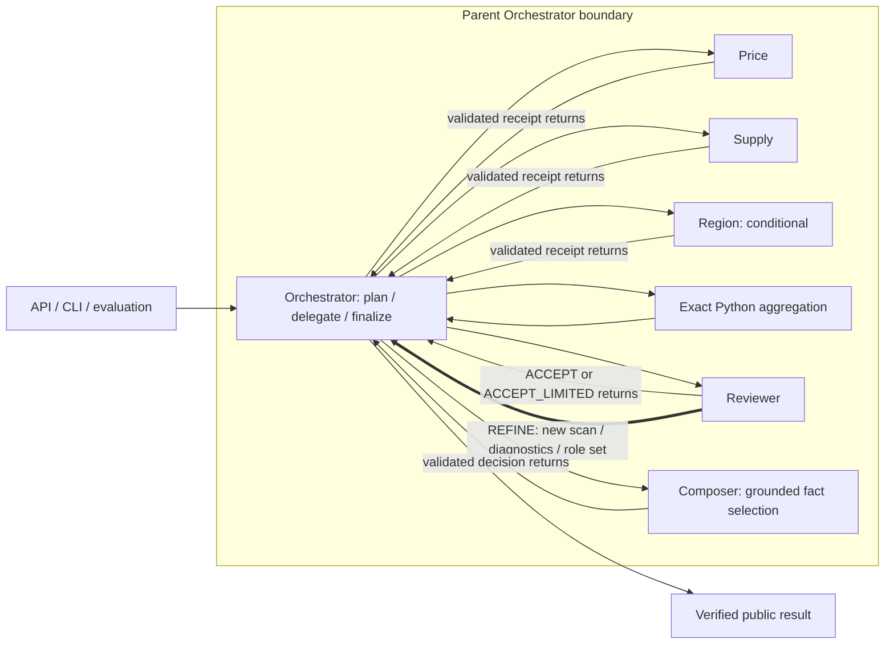

# Housing Evidence: architecture and evaluation design

Version 1, recorded 25 September 2026. This is the repository design note; no earlier submission is claimed. The assignment specifies a team of two and deadline 16 October 2026. Author names have not been supplied.

The application analyzes a frozen, explicitly synthetic Dallas-themed observation feed. It uses Fast Agent 0.10.45 agents as tools. The parent Orchestrator is the only agent invoked by the application service and the only agent returning to it. This pattern is distinct from the native `@fast.orchestrator` planning workflow; the installed-source probe and failed/successful attempts are preserved in [FRAMEWORK_FINDINGS.md](FRAMEWORK_FINDINGS.md).

The graph marks the substantive feedback edge. All calls/returns are mediated by the parent; arrows do not grant children peer-to-peer capabilities. Aggregation is deterministic Python, not another model agent. It consumes verified specialist receipts rather than bypassing role execution.

One [run_analysis](src/housing/workflow/service.py) service serves API, CLI and evaluation. A per-run explicit state machine enforces plan → selection → required scans → aggregation → review → composition → final acknowledgement. Price and Supply are mandatory. Region is public when requested, or a diagnostic activated by a qualifying review. A new scan produces new exact receipts. The parent cannot publish until its actual typed final return is validated.

A coverage mismatch requires an authoritative rescan; confirmed sparsity can be accepted with a limitation after that check. Reviewer feedback changes the selector from indexed to full CSV and can activate Region. It never changes the user's ZIP, property, bedroom, price, size or calendar criteria. At most two distinct semantic refinements are permitted; one explicit schema repair and one framework transport retry have separate budgets, and the SDK does not compound retries. Context is checked before inference.

The recorded auxiliary control [20261001T144318Z-82736e984f](artifacts/traces/20261001T144318Z-82736e984f/trace.jsonl) contains a real loop: indexed Price/Supply found two observations; Reviewer requested REFINE on an intentionally missing index observation plus sparsity; the parent changed to full_csv and added Region; fresh Price/Supply/Region found three observations; Reviewer accepted limited support; Composer and the parent finalized. Its sixteen actual model decisions and successful strict offline replay are preserved. The index omission is explicitly auxiliary. Natural sparse pilot cases also refined, and pilot evidence remains separate from the headline workload.

The feed contains 34,560 generated monthly records, twelve ZIPs, twenty-four months (October 2024 through September 2026) and repeated business listing labels. It contains no personal listing data. Observation count, median raw list price, median individual price/size ratio, monthly/yearly changes and optional pooled regional statistics define the output contract. Exact fractions and integers precede six-decimal half-even serialization. Empty values stay null. [DATA_CONTRACT](housing-tse-codex-handoff/DATA_CONTRACT.md) defines the arithmetic and identity rules; the frozen snapshot and generator manifest ship locally.

| MR | Family | Transformation and expected projection |
|---|---|---|
| MR01 | Invariance | Permute raw rows; canonical statistics unchanged |
| MR02 | Invariance | Bijectively relabel nominal identities; canonical statistics unchanged |
| MR03 | Invariance | Replicate the observation multiset with fresh record IDs; counts double, medians/price changes/ranks unchanged |
| MR04 | Invariance | Change display scale/area units; exact canonical values and transformed display projection |
| MR05 | Monotonic | Strictly widen the price band; counts do not decrease |
| MR06 | Monotonic | Properly restrict ZIPs; counts do not increase, retained ZIP levels stay unchanged |
| MR07 | Directional | Advance the window one month; eleven overlapping rows unchanged and rolling-total identity holds |
| MR08 | Directional | Scale all prices and finite bounds by 5/4; levels scale, percentages and membership persist |
| MR09 | Monotonic | Add USD 1000 to one nonempty month with unbounded price criteria; price median rises by USD 1000 and ratio median has a justified lower bound |
| MR10 | Invariance | Add valid otherwise-eligible rows in an excluded ZIP; canonical statistics unchanged |

Each full [MR catalog](housing-tse-codex-handoff/MR_CATALOG.md) entry specifies its subdomain, witnesses, compared fields, tolerances and fault targets. Independent raw preflight freezes exactly thirty distinct eligible bases per relation before observing model outcomes. The paired seeds are 104729, 130363 and 155921. A base violates if any of its three pairs violates; Wilson intervals use completed bases, not seed runs. Overlapping designed slices and one synthetic feed limit generalization. Eligible output-contract faults are violations, infrastructure errors leave incomplete bases, and every attempt remains visible.

Live calls capture actual parent/child decisions. Offline reproduction uses real Fast Agent playback with exact prompt/schema/tool/model/seed/upstream evidence matching, reruns current tools and checks, and recomputes the MR table. Missing or changed evidence fails closed with no network fallback. Loading saved final answers is not reproduction. The React interface exposes Explore, Workflow, Experiments and Provenance with backend-authored values, linked month selection, raw trace/model drilldowns, exports, and clear synthetic/live/replay/auxiliary/pilot labels. [DESIGN.md](DESIGN.md) documents the final visual system.
