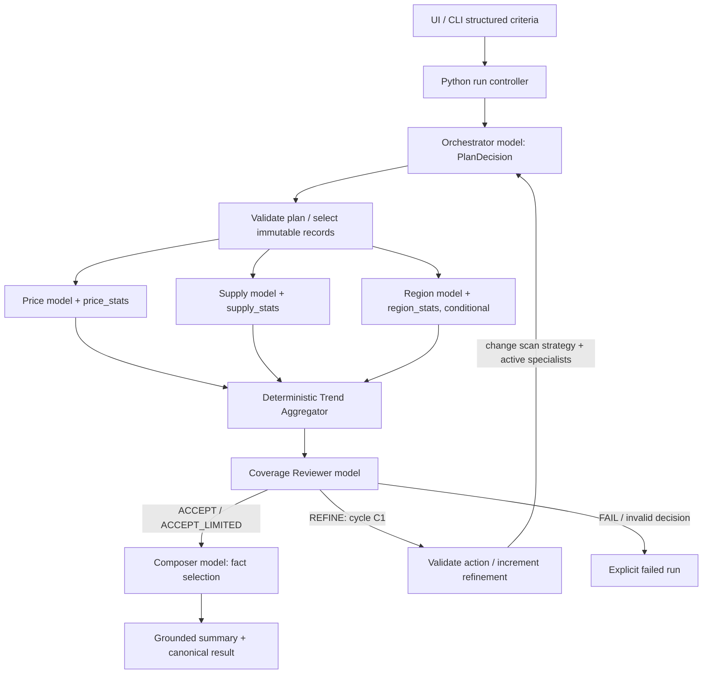

# Runtime architecture and control flow

## Relationship to the delivered files

Both originals are preserved. `housing_trends_agent_architecture.drawio` has three pages with a separate Criteria Interpreter. The later delivered `housing_trends_agent_architecture_no_fills.drawio` still has three pages but merges criteria planning into the Orchestrator. Use that later topology as the structural baseline. Styling preference is the latest user request: white page, subtle fills on boxes, monochrome technical presentation. Do not infer that the older no-fills filename overrides the later fill preference.

Both drawings describe refinement of scope/filters. For implementation, refine **execution scope** (which partitions/path/diagnostic specialists to run) while retaining user criteria. Automatic semantic broadening would conflict with exact MRs. The design note should explicitly record this strengthening. Trend Aggregator is deterministic infrastructure, not an advertised LLM agent. The orchestrator consists of a model planner and a Python state controller; describe that boundary honestly.

**Marked cycle C1:** planner → selection → specialists → aggregation → reviewer → feedback → planner. A second refinement traverses the same cycle with a new plan hash. The back edge has actual execution evidence; it is not merely a graphic.

## Responsibilities, skills and boundaries

| Agent | Skill file | Decision and dependence | Inputs forbidden / capability constraints |
|---|---|---|---|
| Orchestrator | `prompts/orchestrator.md` | Initial specialist set; on feedback chooses the new allowed scan path and adds Region diagnostic | Cannot change canonical query, thresholds, raw data or MR definitions |
| Price | `prompts/price.md` | Emits price-stat tool intent for exact selection; tool returns medians and deltas | Cannot estimate prices, drop rows, choose trimmed median or use display units |
| Supply | `prompts/supply.md` | Requests counts + partition receipts; downstream sparse/completeness signal changes review action | Cannot interpret incomplete partitions as no matches |
| Region | `prompts/region.md` | Optional public comparison or newly required coverage diagnostic | May inspect requested ZIPs; cannot remove a sparse ZIP from query |
| Reviewer | `prompts/reviewer.md` | Chooses ACCEPT/REFINE/ACCEPT_LIMITED/FAIL from evidence; REFINE changes upstream tool implementation and agent set | Cannot claim unsupported numerical confidence or request wider price band |
| Composer | `prompts/composer.md` | Selects grounded fact IDs and caveats; renderer inserts actual values | No statistics tools, free-form numerical invention, external market explanations |

Each Fast Agent role returns JSON only. Typed decisions are defined in `schemas/agent_decision.schema.json`; tools return project-owned Python dataclasses/Pydantic models. Typed tool arguments include dataset view ID, canonical query hash, selection hash, plan version, scan strategy and complete required-month list. Each receipt returns tool version, selected-ID multiset hash, relevant months and exact result references. A model cannot supply a path to a different file or a replacement result.

## Per-run state

Use immutable state updates with `run_id`, `request`, `request_hash`, `dataset_view_hash`, `seed_pair`, `iteration`, `refinements_used`, `plan`, `plan_history`, `selection`, `receipts`, `aggregate`, `review`, `fact_registry`, `trace_sequence`, `deadline`. Content hashes use stable canonical JSON; run IDs and timestamps never enter model prompts. Keep each role's chat context fresh for each semantic invocation. Do not share context between source and follow-up legs, bases or seeds.

| State | Event / guard | Next state / side effect |
|---|---|---|
| CREATED | validated immutable request | PLANNING |
| PLANNING | typed allowed PlanDecision | SELECTING |
| SELECTING | provisional indexed or complete full-scan selection + receipts; raw snapshot complete | SPECIALISTS |
| SPECIALISTS | required roles return valid intents; tools succeed | AGGREGATING |
| AGGREGATING | receipt equality / merge | REVIEWING |
| REVIEWING | ACCEPT with complete support | COMPOSING |
| REVIEWING | first sparse/index mismatch and REFINE | REPLANNING; invalidate old selection/receipts |
| REPLANNING | new allowed action; budget left; distinct plan hash | PLANNING with full_csv + Region |
| REVIEWING | authoritative scan, only sparse support remains, ACCEPT_LIMITED | COMPOSING with limitations |
| REVIEWING | irreconcilable integrity error, invalid decision or exhausted required repair | FAILED |
| COMPOSING | grounded fact selection validates | COMPLETED |
| any active | deadline/model/tool error | FAILED with typed error; never incomplete success |

Model schema parse repair: at most one additional invocation with parse error and original payload; never a hidden loop. Semantic refinement: at most two after initial. Default model-decision deadline60s, whole-analysis deadline300s, numeric tool deadline10s. Record environment-specific overrides; they are not statistical seed parameters. Infrastructure retry once for a transient transport failure, with identical prompt/profile/seed; save every attempt. Exhaustion is an execution error, not a pass. Reject cyclic identical plan hashes.

## Why the loop is necessary

A small count alone cannot distinguish a genuinely sparse query from an incomplete indexed scan. Supply's evidence causes Reviewer to ask the Orchestrator to use the authoritative CSV path and add Region coverage diagnosis. Region can then show which requested ZIP/month cells are sparse; Price and Supply recompute from the authoritative selection. The second result either confirms honest limited support or repairs an indexing omission. A downstream output changes another agent's executed plan. No new housing records are invented, and results retain the requested slice.

`fixtures/feedback_scenario.json` specifies an intentionally omitted index partition and the expected strategy/active-agent change. It is a test control, not an observed failure. Also implement an all-valid narrow slice with natural count<5. The final report may use either, with clear fixture labeling, but must show a trace produced by the live agents. A policy simulation alone is insufficient evidence that the model-agent loop fired.

## Fast Agent mapping

Fast Agent supplies role definitions, model interaction, lifecycle and documented playback; the project supplies bounded state, typed decisions, tool dispatch, exact aggregation, trace events and experimental protocol. Built-in chain/parallel/router/evaluator-optimizer/orchestrator workflows exist, but this project does not assume their policy exactly matches the required graph. Plain Python branching and task gathering around real agent calls are appropriate. Do not invent `CoverageAgent`, `StateGraph` or `FeedbackLoop` as Fast Agent imports. See FAST_AGENT_INTEGRATION for verified calls and the probe.

## Three diagram pages to update in the final repo

1. MAS Topology: six model-agent boxes, controller/aggregator/tools drawn as infrastructure, optional Region path and C1 marked.
2. Specialist Skills: input/output type and tool-intent capability per role, immutable-query boundary.
3. Control Logic: state table, signal definitions, budgets, exact-rescan action and actual trace ID.

Preserve editable Draw.io sources and export PNG/SVG for the report. White page, grey fills, dark outlines, no icons or gradients. Mark conceptual diagrams and runtime evidence separately.
